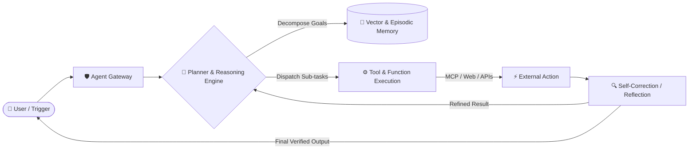

# zamanhaider.dev
🤖 Config &amp; Overview of an Autonomous AI Agent Developer
<div align="center">

<!-- Hero Banner / Typing SVG Animation -->
<a href="https://git.io/typing-svg">
  
</a>

<p align="center">
  
</p>

<!-- Social Badges & Status -->
<p align="center">
  <a href="https://linkedin.com/in/YOUR_LINKEDIN_USERNAME" target="_blank">
    
  </a>
  <a href="https://twitter.com/YOUR_TWITTER_USERNAME" target="_blank">
    
  </a>
  <a href="mailto:YOUR_EMAIL@example.com">
    
  </a>
  <a href="https://YOUR_PORTFOLIO_URL">
    
  </a>
</p>

<p align="center">
  
</p>

---

</div>

## 🌌 About Me

```yaml
identity:
  role: "AI Agent & Autonomous Systems Architect"
  focus: ["Multi-Agent Orchestration", "RAG Systems", "Cognitive LLM Architectures"]
  passion: "Bridging the gap between raw LLM intelligence and production execution"
  core_creed: "Agents don't just chat — they act, solve, and execute."

status:
  current_exploration: "Self-correcting agent swarms & local reasoning models"
  building: "Autonomous coding & research agents"
  ask_me_about: ["LangChain", "CrewAI", "AutoGPT", "Agentic RAG", "Model Context Protocol (MCP)"]
```

---

## 🛠️ The Agentic Stack & Arsenal

<div align="center">

### 🤖 AI Agents, LLM & Reasoning
<p>
  
  
  
  
  
  
  
  
  
</p>

### 🧠 Vector DBs & Retrieval Systems (RAG)
<p>
  
  
  
  
  
</p>

### 💻 Core Programming & Backend
<p>
  
  
  
  
  
  
</p>

</div>

---

## ⚡ Agent Architecture Workflow



---

## 📊 GitHub Analytics & Real-Time Stats

<div align="center">

<p align="center">
  
  
</p>

<p align="center">
  
</p>

<!-- Snake Contribution Graph -->
<picture>
  <source media="(prefers-color-scheme: dark)" srcset="https://raw.githubusercontent.com/YOUR_GITHUB_USERNAME/YOUR_GITHUB_USERNAME/output/github-contribution-grid-snake-dark.svg">
  <source media="(prefers-color-scheme: light)" srcset="https://raw.githubusercontent.com/YOUR_GITHUB_USERNAME/YOUR_GITHUB_USERNAME/output/github-contribution-grid-snake.svg">
  
</picture>

</div>

---

## 🔮 Featured Agent Projects

| Project | Description | Tech Stack | Status |
| :--- | :--- | :--- | :---: |
| **🤖 Autonomous Agent Swarm** | Multi-agent collaboration framework solving complex software engineering tasks | `Python` `LangGraph` `Claude 3.5` | 🚀 Active |
| **🔍 Agentic RAG Pipeline** | Context-aware retrieval system with recursive query decomposition & self-reflection | `LlamaIndex` `Qdrant` `FastAPI` | ⚡ Shipped |
| **🛠️ MCP Tool Connector** | Standardized Model Context Protocol server enabling local tools execution | `TypeScript` `Node.js` `Docker` | 🔬 Research |

---

## 🤝 Let's Connect & Build the Future

<div align="center">

*“The ultimate goal of software isn't just to respond, but to understand, decide, and act.”*

<br/>

<a href="https://linkedin.com/in/YOUR_LINKEDIN_USERNAME">
  
</a>
&nbsp;&nbsp;
<a href="https://twitter.com/YOUR_TWITTER_USERNAME">
  
</a>
&nbsp;&nbsp;
<a href="mailto:YOUR_EMAIL@example.com">
  
</a>

<br/><br/>


</div>
